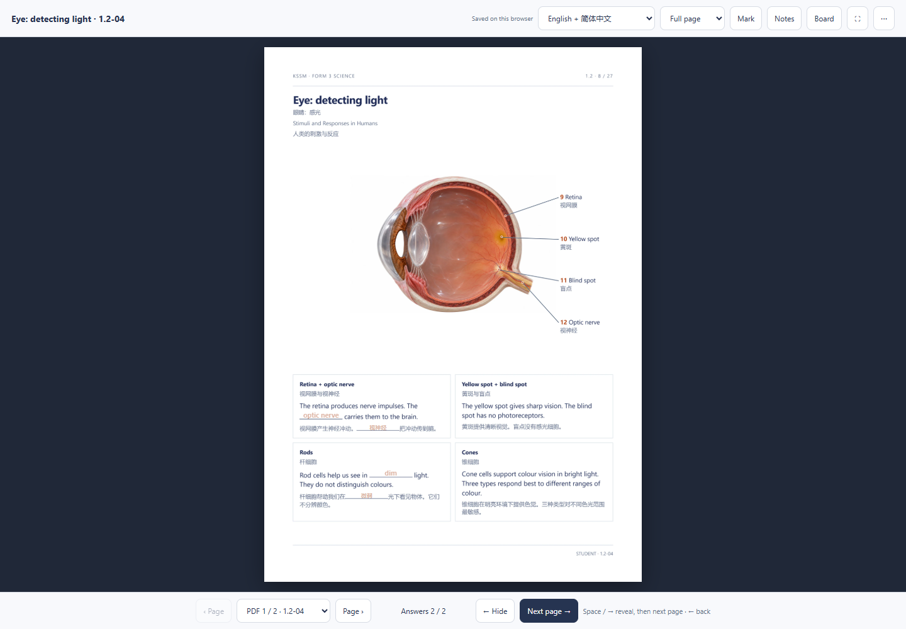

# PDF First Classroom

把课本章节做成学生能跟随的笔记 PDF，再用同一份 PDF 进行课堂讲解。

A reusable AI skill for syllabus-matched notes, teacher answers, and a high-resolution, single-page PDF classroom. Built from an iterated and accepted KSSM Form 3 Science teaching workflow.

## 先看实际例子

下载仓库 ZIP 并解压，然后双击 [classroom.html](examples/eye-detecting-light/classroom.html)。无需账号或服务器。

- [英中学生 PDF](examples/eye-detecting-light/student-en-zh.pdf)
- [全英文学生 PDF](examples/eye-detecting-light/student-en.pdf)
- [教师答案及参考资料](examples/eye-detecting-light/teacher-en-zh.pdf)
- [可编辑课程数据](examples/eye-detecting-light/course.json)
- [可编辑教学文字与答案](examples/eye-detecting-light/lesson-content.json)
- [可编辑打印排版源](examples/eye-detecting-light/print-source.html)

示例是原创“眼睛感光”教学页的节选，含五种语言模式、生成的眼部教学插图和原位答案。它不是官方课本扫描，也不是完整章节。来源及修改经过见 [实际案例](references/accepted-example.md)。



## 已确认的课堂体验

| 操作 | 效果 |
|---|---|
| Space / → | 逐步显示答案；全显示后，下一次按键进入下一页 |
| ← | 逐步隐藏答案；全部隐藏后，下一次按键返回上一页 |
| 返回上一页 | 保留该页已有答案进度 |
| 页面视图 | 整页、适合页宽、150%及全屏 |

答案直接出现在学生 PDF 的对应位置。课堂一次显示一张实际 PDF 页面。翻页采用短而平滑的过渡；放大使用从 PDF 渲染的高清页面。笔记、画笔、画板、可选影片和活动按需打开。

## 给自己的 AI 使用

**Codex**：将本仓库文件夹放入 `~/.codex/skills/pdf-first-classroom`，重新打开会话后使用 `$pdf-first-classroom`。Windows 默认位置为用户目录下的 `.codex/skills/pdf-first-classroom`。

**其他 AI 工具**：把 [SKILL.md](SKILL.md) 和整个仓库交给有文件读写、PDF生成和浏览器检查能力的 AI。它不需要安装 Codex，也不依赖原作者的电脑或网站。工具不支持技能自动发现时，让它先阅读 `SKILL.md`，再按任务需要读取 `references/`。

可以直接复制这段请求：

> 使用这个仓库的 SKILL.md，把我提供的课本章节做成教学包。按官方 chapter / subtopic 顺序制作简短、分块、有填空的学生笔记；英文配简体中文，另附全英文学生版。教师版保留答案与参考资料。课堂以实际 PDF 一次一页呈现，Space / → 显示答案后继续翻页，← 隐藏完后返回上一页。确保放大清楚，并检查全篇排版和每个答案位置。先交付本机版本。

English prompt:

> Use the SKILL.md in this repository to turn the supplied chapter into student notes, teacher answers, and a high-resolution PDF-first classroom. Preserve the official subtopic order, use concise blocks and meaningful blanks, and review every printed page. Space/Right reveals then advances; Left hides then returns. Keep this local until I ask to publish.

## 工作流覆盖什么

1. 核对官方课本、章节顺序与学习标准，补充资料只用已读来源。
2. 制作共享内容源、学生版与教师版，保持题目和答案对应。
3. 检查科学插图、标注、全部 PDF 页面、选项间距和页脚。
4. 从最终 PDF 提取页面及已核对的答案位置，生成单页课堂。
5. 实测方向键、翻页、缩放、保存、返回及减少动态效果。
6. 用户要求发布时，再更新指定平台并检查正式页面。

此 skill 保留了实际批注中确认的要求，包括整篇检查空位并补完整相关题目、不重复续页大标题、删除无用说明、学生版不附参考资料页，以及准确但温和的解剖图。

## 重建这个例子

需要 Python 3.10+。使用虚拟环境后安装依赖：

```sh
python -m pip install -r requirements.txt
python scripts/build_classroom.py examples/eye-detecting-light/course.json classroom.html --width 2380 --max-mib 49
```

将 `classroom.html` 复制给别人即可使用核心课堂功能。可选网络视频仍需联网。精确命令、数据结构及坐标规则见 [实现说明](references/presenter-contract.md)。

构建器负责“PDF + 已核对坐标 → HTML”。它不会自动写出整章、猜答案或从任意 PDF 自动识别全部填空。AI 仍须完成内容核对和真实输出检查。

`lesson-content.json` 保存教学文字；`print-source.html` 是可编辑的打印布局快照；`course.json` 保存各语言 PDF 与答案位置。示例不是自动双向编辑系统。修改文字或排版后，须同步内容源、重新打印 PDF、测量答案位置并检查实际页面，再重建课堂。

示例包含英中2页、英文2页、中文1页、马来文2页、马中2页，教师版3页。核心概念与原始题目相同，补充 Quick check 数量随语言的实际打印排版而异。

## 验证

```sh
python -m unittest discover -s tests
cd tests
npm ci
npx playwright install chromium
npm test
```

Python 检查输入页数、答案、坐标、路径及真实构建。浏览器测试以随附眼睛示例为固定测试样本，检查键盘边界、双语揭示、九张高清页面和保存恢复；不是任意章节的自动内容验收器。可用 `CLASSROOM_HTML` 指向重建的同一示例，`TEST_OUTPUT_DIR` 设置截图目录。`BROWSER_EXECUTABLE` 可指定本机浏览器，未设置时用 Playwright Chromium。

`Pillow` 与 `pypdfium2` 用于 HTML 构建；`pypdf` 与 `reportlab` 提供 PDF 提取、创作及检查所需的工具。已完成独立重建和浏览器试用；未声称实测实体平板、触笔或云端账号服务。

## 范围与授权

示例默认在当前浏览器保存，并提供本机课堂能力。账号同步与网站发布是单独的集成步骤，不包含任何现成后台、账号或密钥。其他老师可以使用自己现有的平台。

代码、文档和原创示例按 [MIT License](LICENSE) 提供。教材引用与第三方站点内容不因被链接而获得再分发授权。示例图片的来源说明见 [案例记录](references/accepted-example.md)。新的课本、照片和参考书请按各自许可使用。

This repository is a portable skill and working example, not a hosted account service. It contains no private classroom library or deployment credentials. Contributions should preserve the print-to-classroom correspondence and verify behavior on the generated artifact.
